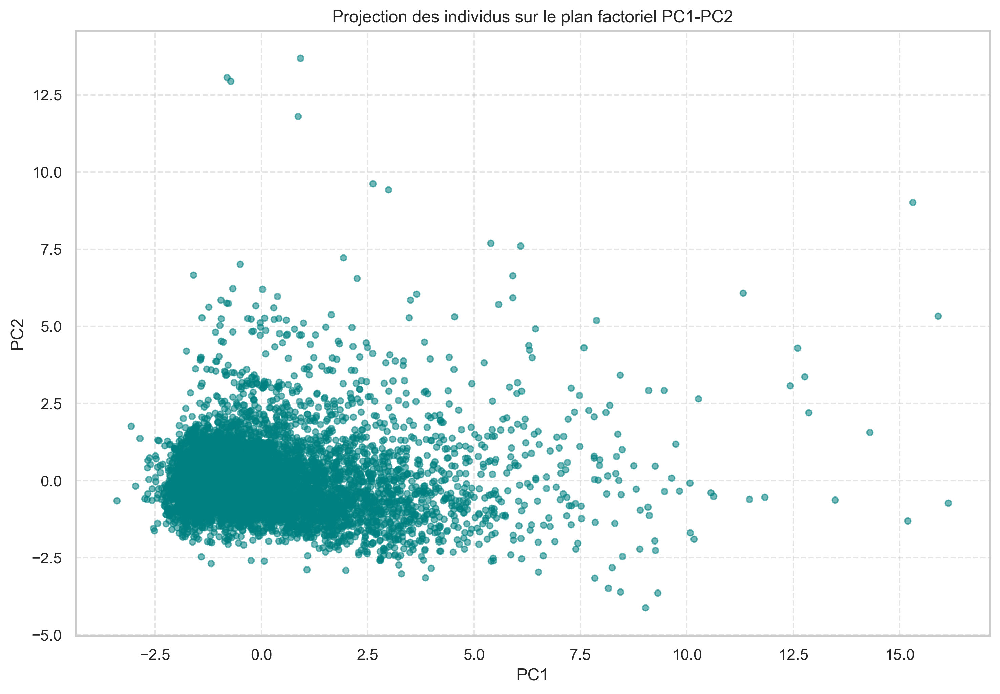

# 🏡 Airbnb Paris — Analyse Multivariée & ACP

<p align="center">
  
</p>

<p align="center">
  <b>Exploration avancée des données Airbnb à Paris à travers une Analyse en Composantes Principales (ACP)</b>
</p>

---

## 🚀 Pourquoi ce projet ?

Dans un marché aussi dynamique qu’Airbnb, comprendre **les facteurs qui influencent les prix et les performances des logements** est essentiel.

Ce projet propose une approche basée sur la **statistique multivariée** pour :

* 🔍 Révéler les relations cachées entre les variables
* 📉 Réduire la complexité des données
* 📊 Identifier les dimensions clés du marché Airbnb

---

## 📊 Aperçu des résultats

### 🔹 Matrice de corrélation

<p align="center">
  
</p>

### 🔹 Projection ACP (PC1 vs PC2)

<p align="center">
  
</p>

### 🔹 Contributions des variables

<p align="center">
  
</p>

### 🔹 Variance expliquée

<p align="center">
  
</p>

---

## 🧠 Méthodologie

Le projet suit une approche rigoureuse :

### 1. 🔧 Préparation des données

* Nettoyage
* Gestion des valeurs manquantes
* Sélection des variables pertinentes

### 2. 📈 Analyse exploratoire

* Statistiques descriptives
* Visualisation des distributions
* Analyse des corrélations

### 3. 📉 Analyse en Composantes Principales (ACP)

* Standardisation des données
* Calcul des composantes principales
* Interprétation des axes factoriels

### 4. 📊 Visualisation

* Projection des individus
* Contribution des variables
* Variance expliquée

---

## 💡 Insights clés

* 📌 Certaines variables sont fortement corrélées avec le prix
* 📌 L’ACP permet de capturer l’essentiel de l’information avec peu de dimensions
* 📌 Des groupes de logements distincts apparaissent clairement
* 📌 Le type de logement influence fortement la structure des données

---

## 🛠️ Stack technique

| Outil                | Utilisation         |
| -------------------- | ------------------- |
| Python 🐍            | Analyse des données |
| Pandas               | Manipulation        |
| NumPy                | Calcul numérique    |
| Seaborn / Matplotlib | Visualisation       |
| Scikit-learn         | ACP                 |

---

## 📂 Structure du projet

```id="7q2n9x"
airbnb-paris-pca-analysis/
│
├── data/                # Dataset
├── notebooks/           # Notebook principal
├── outputs/             # Visualisations générées
├── tables/              # Tables ACP
├── report/              # Rapport final (PDF + LaTeX)
│
├── README.md
├── requirements.txt
└── .gitignore
```

---

## ⚙️ Installation

```bash id="j6mqz6"
git clone https://github.com/Edam-laa/airbnb-paris-pca-analysis.git
cd airbnb-paris-pca-analysis
pip install -r requirements.txt
```

---

## ▶️ Exécution

```bash id="r8axu4"
jupyter notebook
```

Puis ouvrir le notebook principal dans le dossier `notebooks/`.

---

## 📁 Données

Le dataset utilisé contient des informations sur :

* prix 💰
* localisation 📍
* type de logement 🏠
* disponibilité 📅
* caractéristiques des propriétés

---

## 📄 Rapport complet

Le rapport détaillé est disponible ici :

📄 `report/rapport_final_acp_airbnb_paris.pdf`

---

## 🎯 Objectif professionnel

Ce projet démontre :

* ✔ Maîtrise de l’analyse exploratoire
* ✔ Compréhension des méthodes statistiques avancées
* ✔ Capacité à interpréter et visualiser des données complexes
* ✔ Rigueur dans la structuration d’un projet data

-

## ⭐ Support

Si ce projet t’a aidé ou inspiré :

👉 N’hésite pas à **mettre une étoile ⭐ sur le repo**

---

<p align="center">
  <i>Projet réalisé dans le cadre d’une étude en statistique multivariée</i>
</p>
