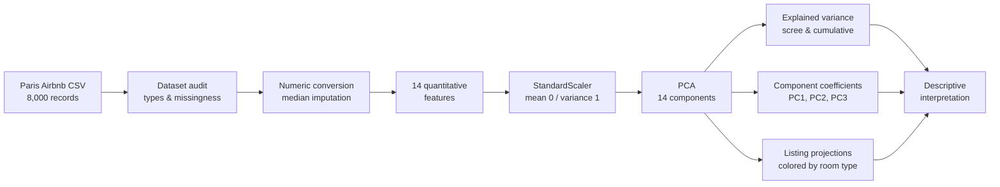
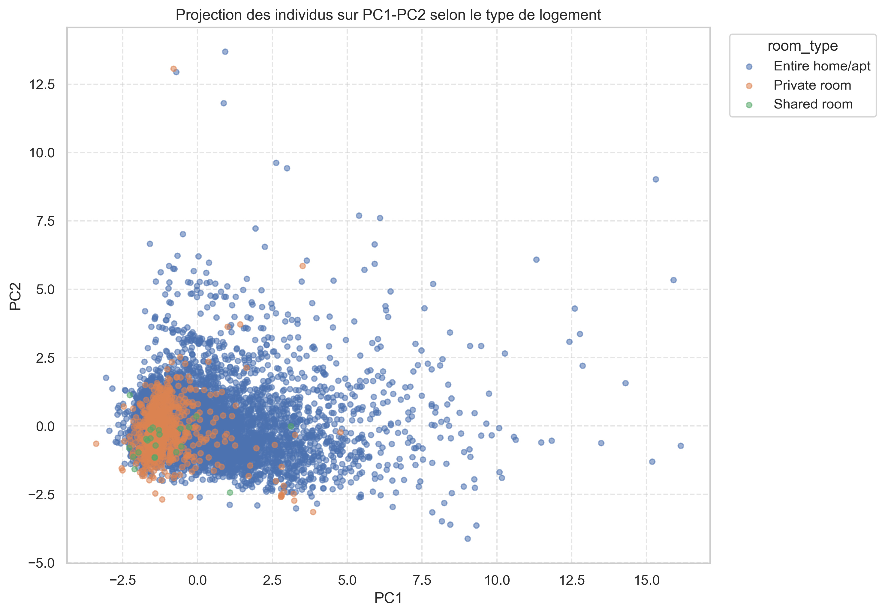
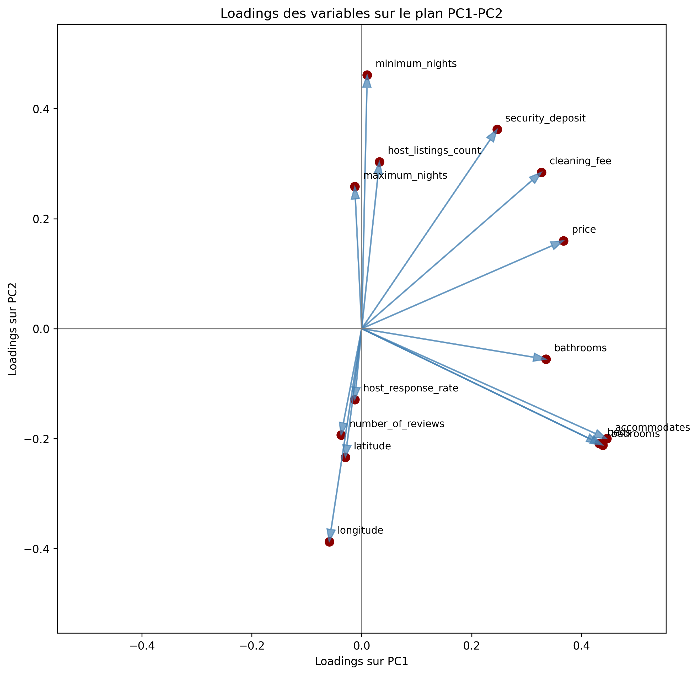
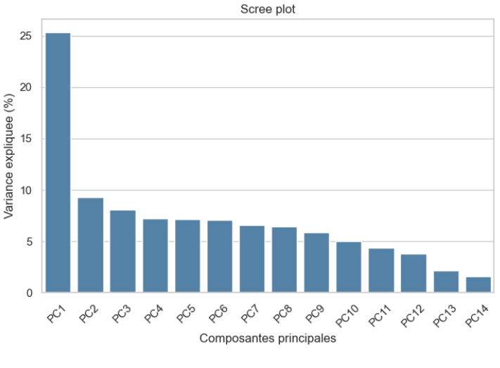
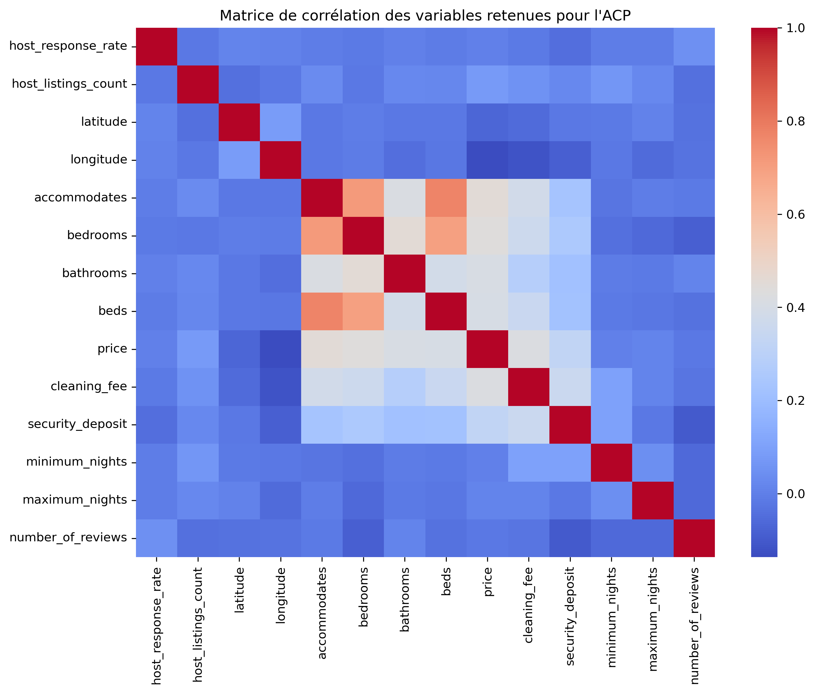

# Paris Airbnb — Principal Component Analysis & Multivariate Exploration

**Python · Pandas · scikit-learn · PCA · Statistical Interpretation · Data Visualization**

An academic exploratory data-science project studying the **multivariate structure of 8,000 Paris Airbnb listings**. The objective is to understand how listing capacity, prices, host characteristics, location and booking rules vary together — and how **Principal Component Analysis (PCA)** summarizes those relationships.

**This is an unsupervised statistical analysis, not a price-prediction system or a causal study.** Importantly, **price is one of the 14 variables used to fit the PCA**; its association with a principal component is therefore descriptive, not a held-out prediction of price.

## At a glance

| Data | Analysis | Recorded notebook outcome |
| --- | --- | --- |
| **8,000 listings** | **19 columns** in the original dataset | Included CSV and notebook |
| **14 quantitative variables** | Median imputation + standardization + PCA | All 14 components evaluated |
| **PC1 + PC2** | Two-dimensional visualization | **34.60%** cumulative variance |
| **PC1 + PC2 + PC3** | Extended axis interpretation | **42.69%** cumulative variance |
| **First 8 PCs** | Higher-information representation | **77.16%** cumulative variance |

*The percentages above are historical notebook outputs, not newly computed or independently validated benchmark results. Higher retained variance does not establish prediction accuracy.*

## Research question

**What dimensions organize the variation between Paris Airbnb listings, and how can we interpret those dimensions without confusing correlation with causality?**

The study addresses three linked questions: which raw variables tend to move together, what the main PCA axes represent, and how the listings are distributed when projected onto a few principal components.

## Analysis workflow



[Read the complete Jupyter notebook](notebooks/airbnb_acp_analysis.ipynb) · [Inspect the CSV](data/paris_airbnb.csv) · [Read the French academic report](report/rapport_final_acp_airbnb_paris.pdf)

## Four visual findings

### 1. Listings in the PCA space



Each point is a listing. Color indicates the original categorical `room_type`, which is used **for visual annotation only**, not as one of the 14 PCA input features. The two-axis projection captures only **34.60%** of total standardized variance, so overlapping groups do not imply that accommodation types are identical in the full feature space.

### 2. Which attributes shape the first axes?



The saved [component-coefficient table](tables/loadings_table.csv) gives the strongest **positive PC1 coefficients** to `accommodates` (~0.446), `bedrooms` (~0.439), `beds` (~0.432) and `price` (~0.367). A cautious interpretation is that **PC1 primarily contrasts larger and smaller listings, with price moving in the same direction in this sample**.

PC2 involves, among other fields, `minimum_nights` (~0.461) and `security_deposit` (~0.362), alongside other correlated and opposing coefficients. It should not be labeled a pure “booking restrictions” axis without reviewing all variable contributions.

The notebook calls `pca.components_.T` *loadings*. Strictly, those stored numbers are **component coefficients/eigenvector entries**; some PCA conventions reserve “loadings” for scaled correlations with components. The sign of a PCA axis is also arbitrary.

### 3. What information is retained?



The first two components explain **34.60%** of the variation; three explain **42.69%**, and eight explain **77.16%**. Keeping two components is useful for a readable scatter plot, but discards most of the standardized variance. Eight components retain more of it at the cost of simplicity.

[View the cumulative variance chart](outputs/composant_peincipale_variance_cumule.png) · [Recorded variance table](tables/explained_variance_table.xlsx)

### 4. Pairwise relationships before dimension reduction



The correlation heatmap offers a **direct view of pairwise linear associations** before PCA combines variables into orthogonal axes. It helps distinguish familiar property-size relationships from the more complex patterns represented by PC2/PC3.

[Explore PC1–PC3 coefficients](outputs/loadings_pc1_pc3.png) · [Inspect the corresponding table](tables/loadings_pc1_pc3_table.csv)

## Data preparation and experimental design

The notebook documents these preprocessing decisions:

1. Inspect **8,000 rows × 19 source columns**, variable types and missing values.
2. Drop `host_acceptance_rate`, which is entirely missing.
3. Convert percentage and currency strings (`host_response_rate`, `price`, `cleaning_fee`, `security_deposit`) to numeric values.
4. Retain 14 quantitative fields including `latitude`, `longitude`, `accommodates`, bedroom/bathroom/bed counts, fees, restrictions, reviews and `price`.
5. Replace missing quantitative values with **column medians**.
6. Apply `StandardScaler`, then `sklearn.decomposition.PCA`.
7. Interpret explained variance, component coefficients and listing projections.

**Missingness deserves attention.** The recorded input contains **3,000 missing host response rates**, **1,750 missing cleaning fees** and **1,680 missing security deposits**. Median imputation is straightforward, but such missingness can change correlations and principal components; alternatives and sensitivity checks would strengthen the analysis.

## Reproduction — what works and what needs adjustment

The dataset, notebook, requirements and saved figures are committed:

```bash
git clone https://github.com/Edam-laa/Analyse-des-facteurs-influencant-les-prix-Airbnb-avec-ACP.git
cd Analyse-des-facteurs-influencant-les-prix-Airbnb-avec-ACP
python -m venv .venv
# Activate .venv for your operating system
python -m pip install -r requirements.txt
jupyter notebook notebooks/airbnb_acp_analysis.ipynb
```

**Important: the notebook is not currently a fully reproducible clean-clone run.** Its initial CSV lookup tries `../paris_airbnb.csv` and `paris_airbnb.csv`, while the repository's actual data file is `data/paris_airbnb.csv`. When running from the `notebooks/` directory, adjust the read path in your **local copy** to:

```python
csv_path = Path("../data/paris_airbnb.csv")
```

The plotting cells also write to legacy `../images/` and `../out_puts/` paths, whereas the committed portfolio figures are in `outputs/`. Create the required output directories or redirect local paths before executing save cells. The existing screenshots are historical exports and are **not evidence that a fresh run was performed** for this README revision.

## Statistical limitations

- **No causality:** a coefficient or correlation does not prove that changing bedrooms, location or host practices will cause a price change.
- **Price is an input:** there is no train/test split, prediction target or RMSE/MAE evaluation; this is not a validated price forecasting model.
- **Two-component plots are partial:** PC1–PC2 represents only 34.60% of variance and may hide separation that exists in later components.
- **Sensitivity to preprocessing:** missing-value treatment, skewed monetary variables, extreme listings and feature selection may substantially change component directions.
- **Sampling scope:** this committed 8,000-listing dataset should not be assumed representative of today's entire Paris Airbnb market; the original collection period and license should be documented.
- **Notebook quality:** clean execution, output-path portability and consistency between generated tables/plots remain to be retested.

## Project artifacts

| Artifact | What it contains |
| --- | --- |
| [Analysis notebook](notebooks/airbnb_acp_analysis.ipynb) | Data audit, cleaning, standardization, PCA, coefficient exploration and projections |
| [Input CSV](data/paris_airbnb.csv) | Original project sample of 8,000 listings |
| [Saved visualization folder](outputs/) | Correlation, variance, component and listing charts |
| [Component coefficient tables](tables/loadings_table.csv) | Numeric coefficients for 14 components |
| [Academic report (French)](report/rapport_final_acp_airbnb_paris.pdf) | Study context and detailed interpretation |

## What this project demonstrates

**Exploratory data analysis · careful preprocessing · multivariate statistics · dimensionality reduction · explainable visualization · interpretation with methodological restraint**

This academic project is most valuable as an example of **reasoning about what data can and cannot establish**, rather than claiming a predictive or causal breakthrough.
